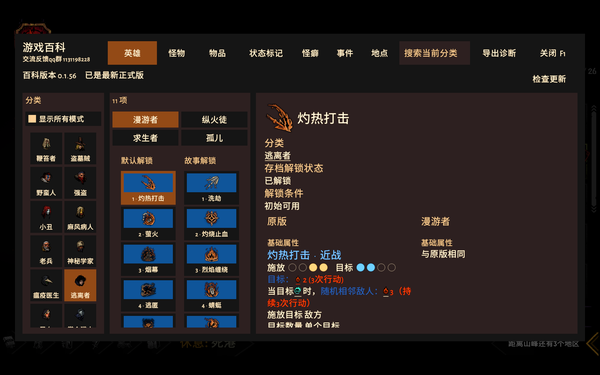
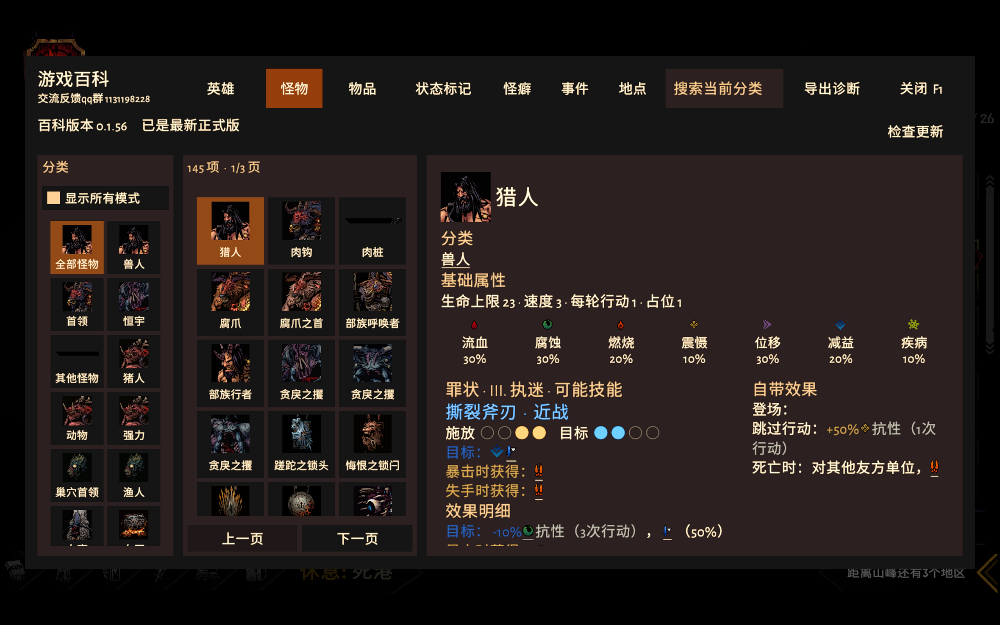
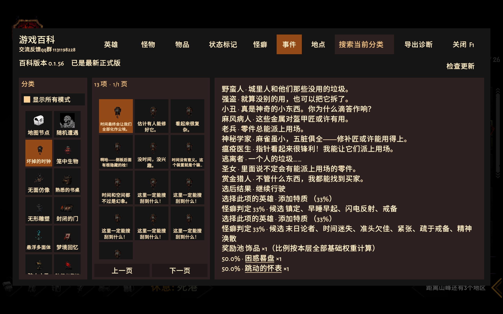

# 《暗黑地牢 II》游戏内中文百科

按 **F1** 打开或关闭百科。百科从游戏数据和当前存档读取内容，包含英雄、怪物、物品、状态标记、怪癖、事件和地点七个页签。条目使用游戏原生名称和图标，未解锁的技能和物品也可以查看。

[下载 Windows 64 位完整包及更新日志](https://github.com/wes7072-max/DD2Wiki/releases/latest)

## 英雄

按英雄和道途查看技能。每个技能显示基础效果、精通效果、伤害、施放站位、目标站位和施放条件。目标说明会区分敌我、能否选自己，以及同时命中多个位置或从中任选目标。技能可以无视的标记也会列出，例如穿刺之箭无视格挡。

默认解锁和故事解锁技能分列显示，故事技能按英雄圣地章节排序，并显示当前存档的解锁状态。选择道途后，有改动的技能用黄色标出，详情并排列出原版与道途版。

## 怪物

显示怪物所属派系、基础属性、抗性、自带效果和技能。怪物技能列出施放条件、效果和命中位置。

战斗中可勾选「只看当前怪物」，查看场上敌人的实际属性和状态。同种敌人按站位区分。属性默认跟随存档模式和难度，也支持预览其他王国难度，以及精英、坚韧、神速等修正。

## 物品

显示物品图标、原生说明、适用条件、升级属性和解锁条件。物品可按类型、标签和适用英雄筛选，包括铭心饰品和英雄专属饰品。点击标签可查看同类物品，点击说明中的关联物品可打开对应条目。

## 状态标记

显示战斗标记和持续效果的图标与作用，包括震慑、目盲、流血、腐蚀、燃烧和再生等。可从技能说明里的高亮词条跳转，也可在战斗提示或 Alt 面板中指向支持的词条后按 F1 查看。

## 怪癖

按正面怪癖、负面怪癖和疾病分类，显示效果、获取条件和已识别的来源，包括英雄初始抽取、旅馆、物品和遭遇选项。条目列出对应来源的触发概率、候选池和单抽参考值。实际候选受英雄、模式和已有怪癖影响。

## 事件

使用同一立绘的同源事件选项归在一起，每个英雄的台词、选项条件、抽取权重和结果分别显示。选项详情列出代价、效果作用对象，以及选择后进入战斗、逃离遭遇或继续行驶等结果。有对应配置的选项会显示火炬增减、精通点、希望蜡烛、侦察距离和侦察概率。

物品和饰品奖励按抽取层级列出候选、数量和本层权重比例；怪癖奖励列出触发概率和候选名单。在事件现场指向英雄选项按 F1，还可查看各队友的态度、当前关系点数及预计变化。

事件页可搜索随机遭遇和地图节点，包括死神、路边援助、绿洲、瞭望塔、巢穴、兽穴和外科医生的手术台。死神条目列出追加遭遇的触发条件，并可跳转到怪物详情。

## 地点

区域条目显示敌对派系、具体怪物和巢穴首领，可点击进入对应详情。地图节点可跳转到关联事件。旅馆条目显示队伍入住效果、适用的王国英雄或传染效果，以及入住时抽取怪癖的概率和数量。

## 搜索与操作

- 鼠标指向支持的英雄、技能、物品、敌人或事件选项，按 **F1** 定位条目。英雄目标中高亮的名称也可定位。
- 在当前页签可按中文名或内部名称搜索。事件搜索覆盖整个事件页。
- 默认按当前存档筛选远征或王国内容，勾选「显示所有模式」可查看两种模式的专属条目。缺少对应 DLC 资源时，条目会标注「缺少 DLC」。
- 点击高亮词条、分类或标签可跳转。**Esc** 返回上一级，在最上一级关闭百科；**F1** 直接关闭。

## 安装与更新

退出游戏，解压完整包，将包内文件复制到《暗黑地牢 II》游戏根目录，与 `Darkest Dungeon II.exe` 放在同一层。已有 BepInEx 5 的玩家可以单独更新 `BepInEx/plugins/DD2Wiki/DD2Wiki.dll`。详细步骤见包内《安装说明》。

百科启动时检查 GitHub 正式版。按 F1 后，页签下方显示本机版本号，点击「检查更新」可手动查询并打开发布页。

## 反馈

点击百科顶部「导出诊断」，可将条目文本、图标和本地化检查结果保存到 Windows 的「文档/DD2Wiki」。反馈缺图或缺文本时，可附上条目名称、模式和对应的诊断片段。

交流反馈 QQ 群 **1131198228** · [提交问题](https://github.com/wes7072-max/DD2Wiki/issues)
